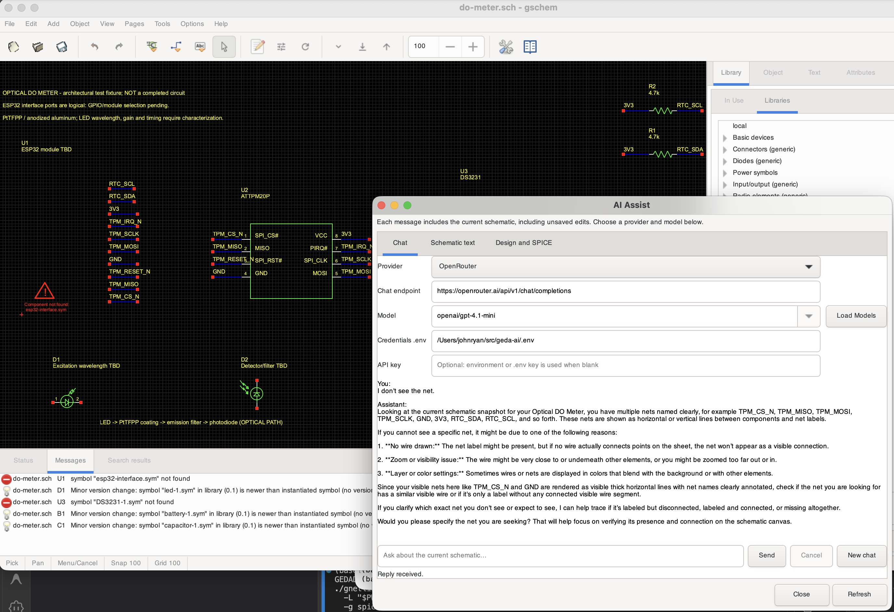

# gEDA-ai

gEDA-ai restores the gEDA schematic tools and adds an AI chat panel that can
read the circuit you are editing. Maintained by **John Ryan, Aquana Press
(Aqnana.net)**, building on the work of the original gEDA authors and community.

**This development checkpoint works on Apple Silicon Macs only.** Other
platforms are not currently supported or verified. The project is under active
repair; it is not a finished electronics design service.

## Product in action



*An optical dissolved-oxygen meter taking shape in gschem, with AI Assist
answering a question about the current schematic through OpenRouter. This
capture predates the fixture launcher fix, so it includes missing-symbol
warnings for the ESP32 interface and RTC. The launcher below now registers
those libraries before loading the drawing.*

The example combines an ESP32 logical interface, a Microchip ATTPM20P security
chip, a DS3231 RTC with coin-cell backup, and the beginnings of an optical
sensing head. It records requirements for adjustable excitation, receiver gain,
and signed, dated calibration records in flash.

**The circuit is incomplete.** The ESP32 GPIO/module selection, LED driver,
photodiode amplifier, ADC, power supply and PCB footprints still need work.
Calibration, flash logging and TPM signing are requirements, not implemented
sensor firmware. See the [fixture notes](gnetlist-legacy/tests/do-meter/README.md).

## What works at this checkpoint

- Schematic display, component placement, attribute editing and net connections.
  A two-resistor connection was checked interactively and by regression tests.
- Symbol previews, bundled icons and drawing refresh repairs.
- `gattrib` attribute editing, saving/reopening, CSV export and menus.
- `gnetlist-legacy` netlist generation: 302 regression passes and two existing
  expected failures, with no unexpected failures.
- AI Assist chat with the current schematic, including unsaved changes.
  A live OpenRouter request using `openai/gpt-4.1-mini` has been verified.

AI Assist offers Ollama, OpenAI, DeepSeek, OpenRouter and compatible endpoints,
with an editable model picker. Replies are advisory: **chat does not place
components or apply circuit changes automatically**. The selected provider
receives the schematic and conversation when you send a message.

## Build on Apple Silicon macOS

The tested development environment uses Homebrew GTK 3, Guile 3, Cairo, Pango,
GLib, Python 3.12, Autotools and the Xcode command-line tools. Dependency setup
and the full-tree build are still being stabilized.

From a checkout with those dependencies available:

```sh
./bootstrap.sh
geda_arg_limit=$(getconf ARG_MAX)
lt_cv_sys_max_cmd_len=$((geda_arg_limit / 4)) ./configure \
  --prefix=/tmp/geda-test PYTHON=/opt/homebrew/bin/python3.12 CFLAGS='-g3 -O0'
```

Build the repaired tools and install their runtime data:

```sh
make -C libgeda -j2
make -C libgedacairo -j2
make -C gschem -j2
make -C gaf -j2
make -C gattrib -j2
make -C gsymcheck -j2
make -C gnetlist-legacy -j2
make -C libgeda install-data
make -C gedai install-data
make -C gschem install-data
make -C gattrib install-data
make -C gsymcheck install-data
make -C gnetlist-legacy install-data
make -C symbols install-data
```

Runtime data and configuration must come from the same release. For the
`1.1.0-20261019` configuration above:

```sh
export GEDADATA=/tmp/geda-test/share/geda-ai-1.1.0-20261019
export GEDADATARC="$GEDADATA"
```

`GEDADATADIR` is the authoritative build variable; `GEDAIDATADIR` is an alias.
The configured data directory includes the release version. Keep debug symbols;
do not use `install-strip` while investigating failures.

## Try the circuit and AI Assist

From the repository root:

```sh
sh gnetlist-legacy/tests/do-meter/view.sh
```

Choose **View → Zoom Extents** to fit the drawing. Open **AI Assist → Chat**,
select a provider, click **Load Models**, and choose a chat-capable model.

For hosted providers, put your own credentials in an untracked `.env`:

```dotenv
OPENROUTER_API_KEY=your-key-here
# Other supported providers:
# OPENAI_API_KEY=your-key-here
# DEEPSEEK_API_KEY=your-key-here
```

Set the absolute `.env` path in AI Assist: the example launcher changes the
working directory, so a blank path will not find a `.env` in the repository
root. Do not commit credentials. See [AI Assist details](gedai/README.ai-assist)
for endpoints, local Ollama use and credential handling.

## Regression checks

```sh
make -C gaf check
make -C gattrib/src check
make -C gsymcheck check
make -C gnetlist-legacy check
make -C gschem/src check
```

The DO-meter fixture has four offline tests covering TPM/RTC pin mapping,
named-net connectivity, a deliberate disconnected-pin error, save/reload,
and calibration requirements included in AI chat context. Run it directly:

```sh
python3 tests/test_do_meter.py
```

These checks validate schematic/software behavior, not physical sensor accuracy,
battery life, cryptographic firmware or a manufactured board.

## Support and contributions

- [Report a bug or request help](https://github.com/tambotitree/geda-ai/issues)
- [Contribute a pull request](https://github.com/tambotitree/geda-ai/pulls)
- [Current TODO](TODO.md)
- [Original authors and contributors](AUTHORS)

Please use the project tracker for current support rather than contacting
historical authors. gEDA-ai is free software; see [COPYING](COPYING).
